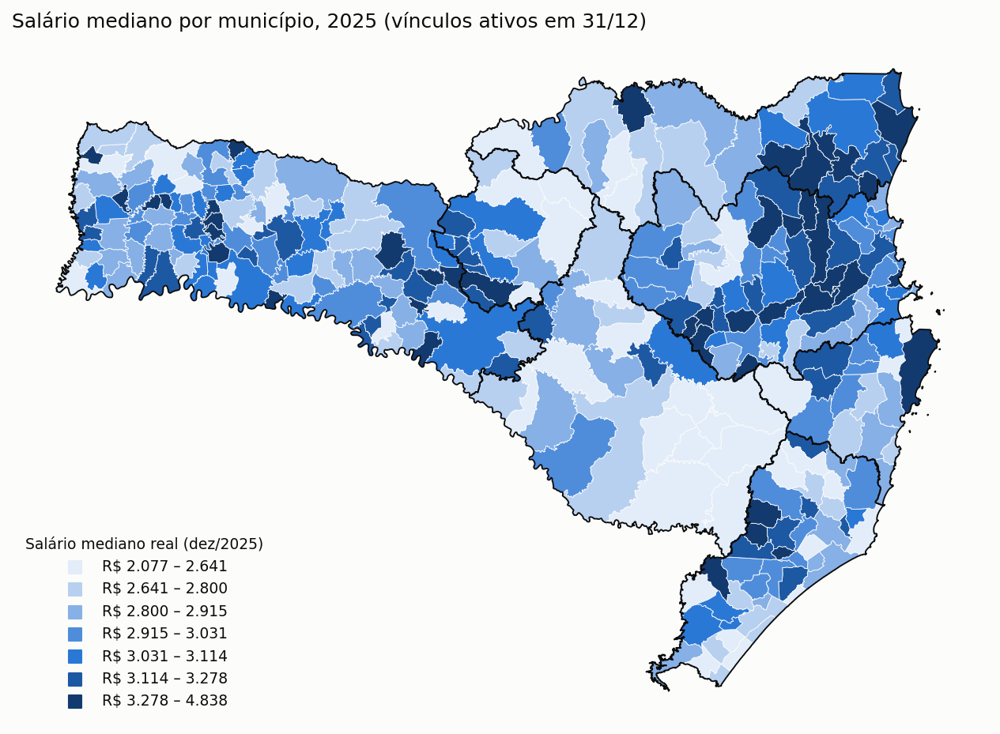
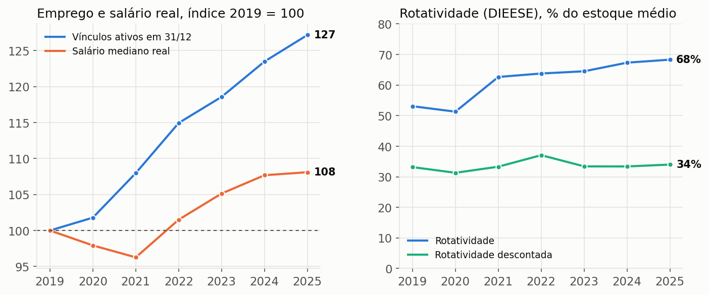
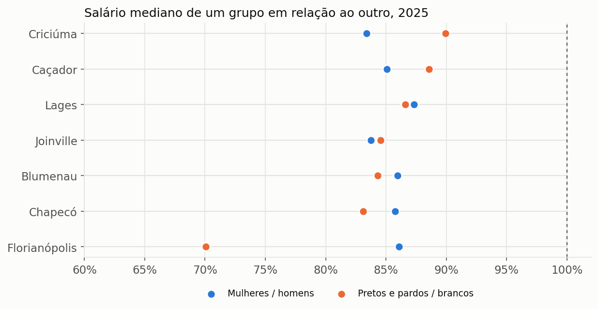
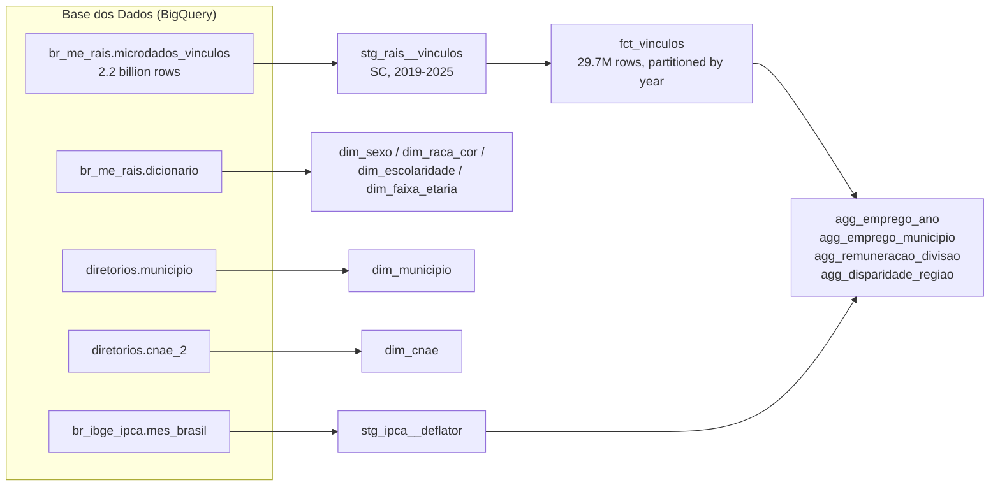

# 💼 Formal Labour Market in Santa Catarina, 2019–2025

Employment, turnover and wages in the Brazilian state of Santa Catarina (SC), from **29.7 million employment-contract records** of RAIS, the Ministry of Labour's annual census of formal jobs. The data is modeled in **dbt on BigQuery** as a star schema at contract grain, with 27 data tests.

Stack: **BigQuery** (RAIS via [Base dos Dados](https://basedosdados.org)) → **dbt** (staging → star schema → analytics marts) → **Python** (charts, map) → BI-ready CSVs.



## Findings

- **Formal jobs grew 27%** in six years (2.32 million active contracts on Dec 31, 2019 → 2.95 million in 2025), and the **median real wage grew 8%** (R$ 2,863 → R$ 3,095 at December 2025 prices). Wages lost ground until 2021 (−4%) and only passed the 2019 level in 2022.
- **Turnover rose, but it was workers who left.** Gross turnover went from 53% to 68% of the average stock. Turnover *net of* quits, transfers, retirements and deaths (the DIEESE definition) stayed flat at ~33–34%. Quits went from 30% to 42% of all dismissals, the sign of a tight labour market.
- **Women earn 83%–87% of men's median wage** in every one of the 7 regions (2025).
- **The largest racial gap is in the capital's region:** Black and *pardo* workers earn 70% of the white median in the Florianópolis region, against 83%–90% in the other regions.
- **Ranking sectors by mean or by median gives different orders.** Education has a higher mean than Machinery manufacturing (R$ 6,392 vs. R$ 5,435) but a lower median (R$ 3,615 vs. R$ 4,148). Wage statistics here use the median unless stated otherwise.





## Why this project was rebuilt

The first version of this analysis (2026) used yearly CSV extracts of RAIS for SC, 2020–2022, processed with a Python ETL. Those files showed active contracts jumping **52% from 2021 to 2022**, which made the time series unusable. The suspicion then was that 2020 and 2021 were partial extracts.

With the complete RAIS (the `comparacao_extracao_v1` model) the suspicion is confirmed:

| Year | Active contracts, complete RAIS | Active contracts, CSV extract | Coverage |
|---|---|---|---|
| 2020 | 2,360,682 | 1,465,363 | 62% |
| 2021 | 2,504,231 | 1,536,947 | 61% |
| 2022 | 2,665,743 | 2,337,448 | 88% |

The real growth in 2022 was **+6.5%**, not +52%. The "break" was in the extract, not in the economy. The modeling decisions of the first version were kept: contract grain, role-playing month dimensions turned into flags, medians against outliers, and explicit handling of zero wages and missing race/color.

## Data model



| Layer | Dataset | Content |
|---|---|---|
| Staging | `rais_sc_staging` | views over Base dos Dados; filters SC and years at the source (partition pruning: ~2.8 GB scanned per full build) |
| Core | `rais_sc_core` | `fct_vinculos` (grain: one contract per year, partitioned by year, clustered by municipality and CNAE division) + 6 dimensions |
| Analytics | `rais_sc_analytics` | aggregated marts with exact medians, exported to `data/marts/*.csv` |

**Why contract grain:** an average can be rebuilt from sums and counts, a median cannot. Aggregating early would make every median in this README impossible.

### Definitions

| Metric | Definition |
|---|---|
| Active contracts | `vinculo_ativo_3112 = 1` (active on December 31) |
| Initial stock | contracts admitted in a previous year (employed on January 1) |
| Turnover (DIEESE) | min(admissions, dismissals) / average of initial and final stock |
| Turnover net of voluntary exits | same, without dismissals for quits (21–22), transfers (30–34), deaths (60–64) and retirements (70–80) |
| Real wage | December wage × IPCA(Dec of last year) / IPCA(Dec of the year); active contracts with wage > 0 |
| Gaps | ratio of medians between groups; race/color only where informed, with coverage reported |

## Data quality: what the tests caught

**27 tests** run with the build, among them:

- **Stock identity:** initial stock + admissions − dismissals = active on Dec 31, every year (0.5% tolerance).
- **Plausible flows:** initial stock > 50% of the active stock, and admissions < contracts. This test exists because of a real bug: from 2023 the source codes "admitted in a previous year" as `0` instead of `null`. With the wrong code, every 2023–2025 contract counted as an admission, and the stock identity *still closed*.
- All 295 municipalities of SC in every year; referential integrity of the fact against all 6 dimensions.
- At most 0.1% of active contracts without a CNAE division. The CNAE directory has one class listed twice (a line break inside the division name), which the uniqueness test caught.

## Caveats

- **Zero wages:** 5%–10% of active contracts have no December wage and are excluded from wage statistics.
- **Race/color coverage** went from 55%–80% (2019, depending on the region) to ~97% (2025). Racial gaps are comparable *within* a year, not as a trend.
- **Extreme wages** (above R$ 100k/month) are concentrated in port cities and associations; the first version's hypothesis is dock-worker pools (OGMO) paying a shared amount through one contract. Medians are immune to them, and means are shown only next to medians.
- RAIS counts **contracts**, not people: one person can have two contracts.

## How to run

```bash
python -m venv .venv && source .venv/bin/activate
pip install -r requirements.txt
gcloud auth application-default login
export GCP_PROJECT_ID=your-project        # BigQuery Sandbox works (free, 1 TB of queries/month)

dbt build --profiles-dir .                # ~3 GB scanned; datasets rais_sc_* in the US region
python analysis/charts.py                 # export marts to data/marts and draw docs/img
python analysis/charts.py --offline       # charts only, from the versioned CSVs
```

Change the state or the years with `--vars '{uf: PR, first_year: 2021, last_year: 2025}'`.

## Repository structure

```
├── models/
│   ├── staging/          # sources + stg_* views (RAIS, dictionary, directories, IPCA)
│   ├── marts/core/       # fct_vinculos + dimensions
│   └── marts/analytics/  # aggregated marts
├── macros/               # code_dimension(), wage_base(), schema names
├── tests/                # stock identity, plausible flows, coverage
├── seeds/                # extracao_v1.csv (counts of the first version, for comparison)
├── analysis/charts.py
├── data/marts/           # exported marts (CSV)
├── data/reference/       # SC municipalities and regions (IBGE, simplified GeoJSON)
└── docs/img/
```

Data: RAIS (Ministério do Trabalho e Emprego) and IPCA (IBGE) via Base dos Dados · municipal boundaries: IBGE.

---

**Rodrigo Jacques Wolff** · Analytics Engineer · [LinkedIn](https://www.linkedin.com/in/rodrigo-jacques-wolff/)
